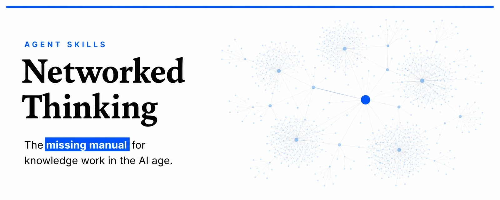

# Networked Thinking Skills

[](https://github.com/jrgilbertson/networked-thinking-skills/actions/workflows/ci.yml)
[](LICENSE)



Agent Skills and deterministic helper scripts for Networked Thinking notes and tasks in Obsidian vaults.

## Purpose

Networked Thinking is a book and practical system for turning saved articles, highlights, and notes into usable context for writing, decisions, and work. This repo ships the agent-side tooling for the system, from the forthcoming book by Jason Gilbertson and Terri Yeh. The [companion vault](https://github.com/jrgilbertson/networked-thinking) shows the full system these skills operate on. Learn more and join the waitlist at [networkedthinking.ai](https://networkedthinking.ai/).

## Skills

| Skill | What it does |
|---|---|
| `atomic-note` | Create or improve a single-concept note in DAE format. |
| `atomic-note-audit` | Review selected notes with model judgment and exact integrity checks; deliver one numbered Markdown report that retains decisions and verified outcomes. |
| `managing-obsidian-tasks` | Manage Obsidian tasks from capture to completion. |

More skills will land here as the book's workflows do; each installs independently.

## Quickstart

Install the official Obsidian skills first if you plan to run remediation:

```bash
npx skills add kepano/obsidian-skills -g
```

Install the Networked Thinking skills:

```bash
npx skills add jrgilbertson/networked-thinking-skills -g
```

Add `--skill <name>` to install a single skill.

Update installed skills:

```bash
npx skills update
```

## Usage

In an agent session opened on your vault, run a read-only audit first, then create or improve notes:

```text
Use atomic-note-audit to audit the quality of my atomic notes.
Use atomic-note to turn this highlight into an atomic note.
Create a todo to compare this article with my codebase.
```

To continue later, ask the agent to process selected item numbers in the audit report. Its visible recommendations and action history are durable; temporary working files can be rebuilt. Reports use `<YYYYMMDDHHMM> Atomic note audit.md` directly in the configured audit output folder.

Always run the audit before remediation and review the generated plan before allowing vault mutation. Remediation can edit, split, relink, or delete vault files. The deeper guides cover the [audit workflow](docs/audit-workflow.md), the [remediation runbook](docs/remediation.md), and the [scoring rubric](docs/rubric.md).

## Contributing

Issues and PRs are welcome. Read the [contributor guide](docs/contributor-guide.md) first; questions go to the [issue tracker](https://github.com/jrgilbertson/networked-thinking-skills/issues). Notable changes are listed in the [changelog](CHANGELOG.md).

## License

MIT. See [LICENSE](LICENSE).
