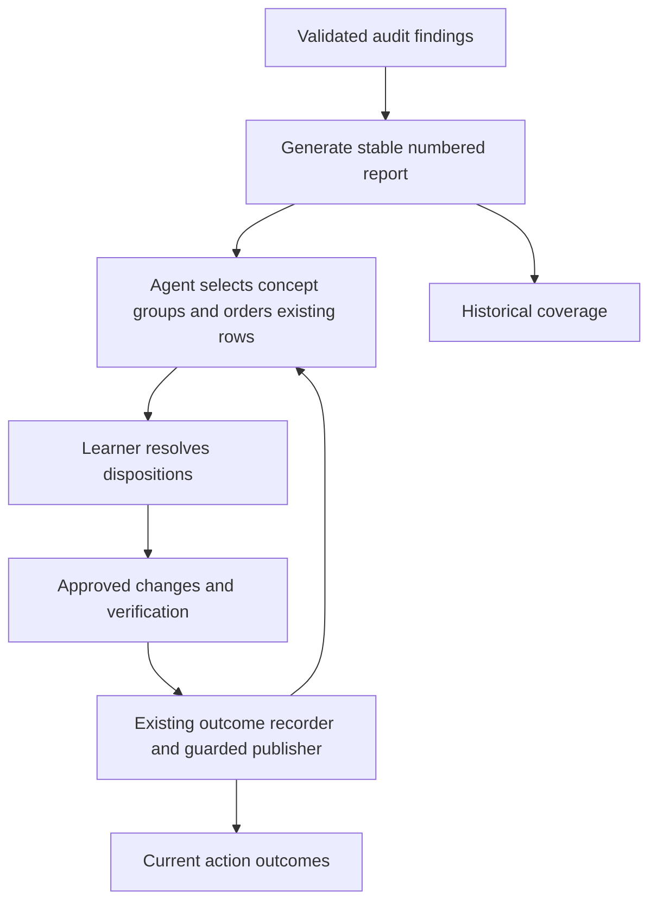

# Concept Group Audit Review - Plan

## Goal Capsule

Make atomic-note remediation coherent across related concepts while distinguishing durable knowledge from what the learner wants to memorize.
Ship one PR in the isolated issue-66 worktree, using existing Markdown records and helpers.
The agreed retrospective and issue #66 authorize implementation and PR creation; merging and live-vault or installed-skill changes are outside this work.
Stop only for a demonstrated scope conflict or an unsafe change to existing record identity.

## Product Contract

### Requirements

**Review workflow**

- R1. Group review by conceptual relationship, with repair priority secondary inside each group and no fixed batch size; urgent integrity problems may interrupt the order.
- R2. Choose keep/refocus, retain without Anki, consolidate, or retire before drafting, using established learner preferences and approvals while holding unresolved decisions.
- R3. Preserve personal interests, factual recall, useful reference calculations, and foundational equations needed to define a concept; do not impose an occupation-based filter.

**Consistency and records**

- R4. Align maintained templates with short YAML title/H1 and a Definition-derived filename; identify local conflicts without silently changing a vault's templates.
- R5. Verify the final concept, question, aliases, example, and meaningful graph connections together, repairing parent entries in place.
- R6. Preserve item/action identities, outcomes, and selected conceptual order through recording and regeneration. Separate current action dispositions from historical model-review coverage.
- R7. Keep all fixtures synthetic and both installable skills self-contained.

### Scope boundaries

No clustering database, new taxonomy, score changes, automatic vault migration, or live notes in this repository.
The separate follow-up for richer Anki history, scheduling, recovery, and large-scale verification helpers remains deferred.

## Planning Contract

### Key technical decisions

- KTD1. Represent concept groups as visible prose listing existing item numbers before the single action table; reorder that table without changing IDs. Preserve the selected order on regeneration and append newly discovered rows for explicit regrouping. This uses the existing parser's preserved prose and row-order contract. (session-settled: user-directed — chosen over fixed-size global-priority batches: related concepts should be reviewed together.)
- KTD2. Keep grouping a semantic agent decision based on existing links, parents, aliases, sources, and content; priority remains the initial deterministic fallback until groups are chosen. No automatic clustering helper is needed for R1.
- KTD3. Put purpose and recall disposition before DAE drafting in the owning skill workflows; clarify Reference use without changing scoring or model-judgment contracts. (session-settled: user-approved — chosen over removing useful knowledge along with cards: durable reference value and memorization value differ.)
- KTD4. Keep the five-column format and hidden identity markers unchanged. Add a recognizable generated current-action summary to new reports, refresh it from the latest recorded outcome per action, and treat unknown historical outcomes as unresolved. Existing reports without the summary remain readable and gain it through generation. Refuse to overwrite edited generated summaries.
- KTD5. Fix the maintained synthetic template in `shared/scripts/make_fixture_vault.py` and its checked-in fixture; document that these demonstrate naming rather than constitute an installed live-vault template manager.

### Behavior flow

### Assumptions and local evidence

`audit_review_report.py` already round-trips row order, prefix/suffix prose, and identities; `reporting.py` currently overrides order with a global priority sort.
`record_audit_outcome.py` appends dated outcomes and renders the same record, providing the shared refresh point.
`doctrine.md` already distinguishes filename/Definition from title/H1 and supports learner-specific recall; this change clarifies workflow rather than inventing a new quality rubric.
The maintained tiny-vault template lacks a YAML title and uses ambiguous `{{title}}`, so it needs explicit concept-title and Definition placeholders.
Relevant precedents are the naming-alignment and learner-purpose documents under `docs/solutions/`.

## Implementation Units

### U1. Establish concept and recall review guidance

**Goal:** Implement R1–R5 in the owning instructions without duplicating mutation protocols.
**Dependencies:** None.
**Files:** `skills/atomic-note/SKILL.md`, `skills/atomic-note-audit/SKILL.md`, `shared/references/doctrine.md`, `shared/references/remediation-context.md`, `shared/references/audit-review-record.md`, template source and fixture.
**Approach:** Apply KTD1–KTD3 and KTD5; keep one source for each rule and reference existing source, rename, and Anki safeguards.
**Test scenarios:** Review synthetic connected probability notes as one group, a separate two-note computing group, and an unrelated personal-recall note; keep useful equations while declining dedicated formula recall; retain explicit personal fact practice. Check the template's two naming pairs.
**Verification:** Inspect guidance against current doctrine and existing atomic-note examples; exercise behavior-sensitive examples through the report tests in U2.

### U2. Preserve group order and truthful action summaries

**Goal:** Implement R6 with existing report helpers.
**Dependencies:** U1.
**Files:** `shared/scripts/reporting.py`, `shared/scripts/audit_review_report.py`, `tests/test_model_led_reporting.py`, `tests/test_audit_review_report.py`, relevant recorder tests and report golden.
**Approach:** Apply KTD1 and KTD4. Keep initial priority ordering, preserve existing row order on refresh, append new findings, and replace priority-first opening advice with concept-review guidance. Label capture counts explicitly as audit-time findings. Count each action's final recorded outcome, including held/partial/unknown as outstanding; keep declined distinct from completed. Preserve older generated recommendation/coverage compatibility.
**Test scenarios:** Regroup five rows into uneven concept groups with priority secondary, record an outcome, regenerate with new findings, and verify unchanged IDs/history/prose/order. Exercise completion, decline, held, partial, unknown legacy status, a new action on a completed item, and edited-summary refusal. Check old reports without summaries still round-trip and record successfully.
**Execution note:** Establish failing focused regressions for order preservation and summary refresh before implementation.
**Verification:** Run focused report and outcome tests and regenerate the deterministic golden from the existing synthetic fixture.

### U3. Synchronize and validate the release

**Goal:** Deliver R7 and documented compatibility.
**Dependencies:** U1, U2.
**Files:** `pyproject.toml`, version constants and applicable fixtures, `CHANGELOG.md`, `CONCEPTS.md`, generated `skills/*/references` and `skills/*/scripts`.
**Approach:** Bump package and doctrine clarification contracts only; preserve schema, rubric, model prompt, and identity-format versions. Sync shared artifacts. Record that behavioral instruction checks do not prove autonomous model performance.
**Test scenarios:** Both installed skill copies import and run the report helpers; legacy report format and JSONL validation remain accepted.
**Verification:** `python3 -m shared.scripts.sync_skill_artifacts`; `lefthook run pre-commit --force --no-auto-install`.

## Verification Contract

Focused report regressions must fail before their fix and pass afterward.
The full repository pre-commit gate must pass, including unit tests, golden JSONL validation, install command checks, and synchronized generated artifacts.
Review the final diff for private content, unwanted score/schema changes, and accidental default-branch or live-vault edits.
No browser test is necessary for this Python/Markdown-only change; no live Obsidian/Anki mutation is part of validation.

## Definition of Done

All U-IDs implemented; concept grouping survives regeneration, current outcomes are distinguishable from audit coverage, and the two skills teach the agreed recall/naming/consistency rules.
Checks pass and an issue-linked PR is open with CI decided, documenting the separate Anki-tooling follow-up and the absence of live-vault migration.
